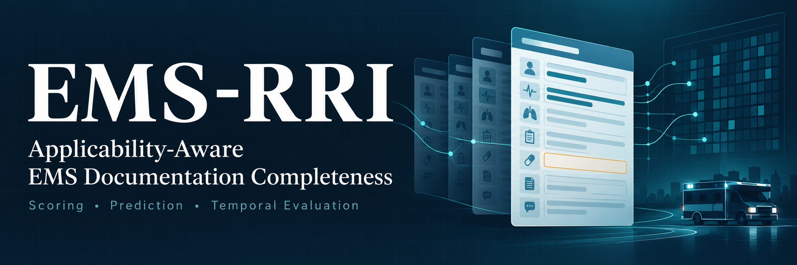
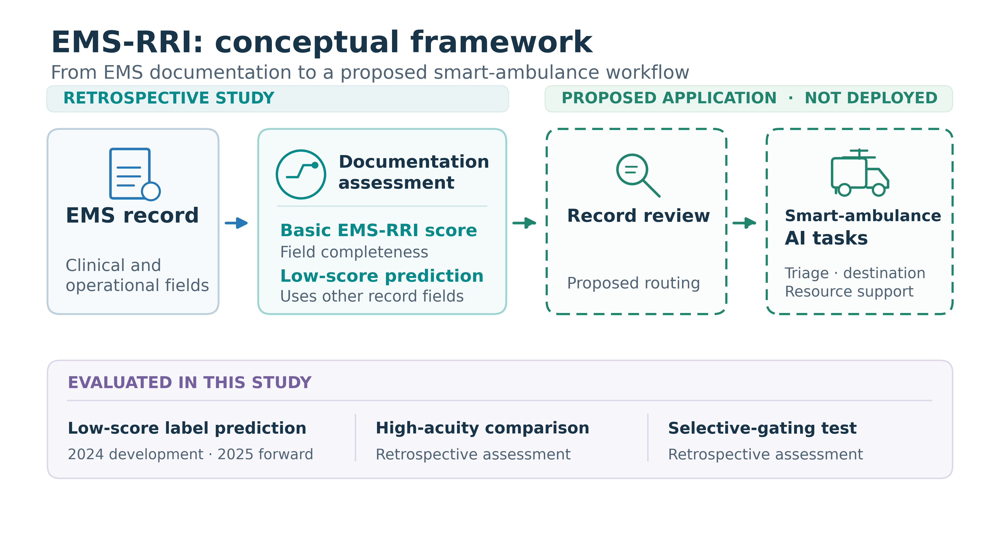

**Research code accompanying an accepted peer-reviewed manuscript:**

> **Applicability-Aware Reliability Scoring and Prediction of EMS Patient-Care Records for Trustworthy Smart Ambulance AI**  
> Sumit Barua, and Bahar Mahmud 
> *AI* · Accepted 15 October 2026 · Publication DOI pending

<!-- **Authors:** Sumit Barua and Bahar Mahmud -->

## Overview

The EMS Record Reliability Index (EMS-RRI) measures the percentage of selected applicable fields documented in an EMS record. It includes 21 elements across five domains: dispatch, disposition, response, cardiac arrest, and scene information. A secondary formulation weights elements by the inverse number of selected elements in their domain.

This repository supports score construction, prediction of the score-derived low-reliability label, forward temporal evaluation, and retrospective downstream analyses. EMS-RRI measures selected-field documentation completeness; it does not establish factual accuracy or clinical reliability.

### Study design

| Component | Configuration |
|---|---|
| Development data | 200,000 records from 2024 |
| Primary model partitions | 140,000 training; 30,000 validation; 30,000 internal test |
| Forward evaluation | 500,000 records from 2025 |
| Primary classifier | XGBoost with 32 contextual predictors |
| Low-reliability label | Basic EMS-RRI at or below the 2024-training 20th percentile: 81.8182 |
| Primary probability threshold | 0.37, selected by validation F1 |

The downstream high-acuity analyses use separate eligible subsets and stratified partitions, as described in the manuscript.

## Analysis Pipeline



*Workflow from NEMSIS event preparation and applicability-aware
scoring to model development using 2024 records, forward evaluation
on 2025 records, and retrospective downstream analyses.*

## Repository structure

```text
emsrri/
├── README.md
├── CITATION.cff
├── requirements.txt
├── .gitignore
├── preprocessing/   # Event preparation and EMS-RRI scoring
├── analysis/        # Individual experiments as Python scripts
├── notebooks/       # Corresponding Jupyter notebooks
├── reference/       # Scoring rules and documentation-audit reference
├── tools/           # Input checks
├── tests/           # Synthetic scoring tests
└── docs/            # Detailed workflow and reproducibility notes
```

The Python scripts and corresponding notebooks contain equivalent analysis code. Choose either interface; there is no need to run both. Keep both files in `reference/`: notebook setup uses the JSON file to locate the repository, and the documentation-state audit reads the reference notebook.

## Installation

Download or clone the repository, then open a terminal in its root directory—the directory containing this README. Use Python 3.10 or later in an isolated environment.

```bash
python -m venv .venv
```

Activate the environment on macOS or Linux:

```bash
source .venv/bin/activate
```

Or on Windows PowerShell:

```powershell
.venv\Scripts\Activate.ps1
```

Install the dependencies:

```bash
python -m pip install -r requirements.txt
```

The requirements list is not a frozen record of the original study environment. Dependency versions may affect numerical results.

## Prepare the analysis inputs

No NEMSIS records, patient identifiers, trained models, or saved notebook outputs are distributed. Obtain the research data separately through the NEMSIS Technical Assistance Center's data-access procedures.

The experiments require the prepared event-level Parquet files, including the EMS-RRI scores and analysis predictors:

| Input file | Expected records |
|---|---:|
| `work/datasets/nemsis_2024.parquet` | 200,000 |
| `work/datasets/nemsis_2025.parquet` | 500,000 |

These are prepared analysis files, not raw NEMSIS exports. Preserve the original row order, column types, values, and four-decimal score precision. Fixed-seed partitions depend on row order.

Run the input checker before starting an experiment:

```bash
python tools/check_inputs.py
```

It checks core columns, record counts, missing scores, and score ranges, and prints the training-derived cutoffs. It does not establish that the files reproduce the original study inputs.

### Use a different data directory

By default, analyses read inputs and write outputs beneath `work/`. To use a private directory elsewhere, set `EMS_RRI_ANALYSIS_ROOT` before running a script:

```bash
export EMS_RRI_ANALYSIS_ROOT="/absolute/path/to/private/emsrri-work"
```

In PowerShell:

```powershell
$env:EMS_RRI_ANALYSIS_ROOT = "C:\path\to\private\emsrri-work"
```

That directory must contain `datasets/nemsis_2024.parquet` and `datasets/nemsis_2025.parquet`.

## Run the experiments individually

Run each command below from the repository root with the environment activated. Start with Experiment 01 to check the primary model workflow, then select the analyses you need. Wait for one experiment to finish before starting the next.

The numbering organizes the release; it does not represent the chronological order of model development. Most scripts fit their own models directly from the prepared inputs. Running all experiments can require substantial time and memory, especially the bootstrap analyses.

### 01 — Forward temporal validation

Train the final 32-predictor model using 2024 data, select the probability threshold on the validation partition, and evaluate on the internal test and 2025 data.

```bash
python analysis/01_forward_temporal_validation.py
```

### 02 — Score-cutoff sensitivity

Compare low-reliability definitions based on alternative training-score percentiles.

```bash
python analysis/02_cutoff_sensitivity.py
```

### 03 — Failure cases and three-tier predictions

Examine errors near the score cutoff and evaluate the high-recall threshold and three-tier classification.

```bash
python analysis/03_boundary_three_tier.py
```

### 04 — Calibration, uncertainty, and decision analysis

Estimate bootstrap intervals, assess probabilistic calibration, and evaluate exploratory decision-curve net benefit.

```bash
python analysis/04_calibration_uncertainty_decision_analysis.py
```

### 05 — Predictor-domain ablation

Refit models after removing each predictor domain and report total and per-predictor ROC-AUC changes.

```bash
python analysis/05_domain_ablation.py
```

### 06 — Downstream high-acuity prediction and selective gating

Compare the baseline and EMS-RRI-enhanced high-acuity models, estimate paired uncertainty, and assess score-based gating.

```bash
python analysis/06_downstream_acuity_selective_gating.py
```

### 07 — Subgroup performance and temporal drift

Evaluate geographic and urbanicity subgroups, predictor-distribution changes, and the exploratory Frontier analysis.

```bash
python analysis/07_subgroups_drift_frontier.py
```

### 08 — Documentation-state ablation

Audit scoring-element overlap and compare original, collapsed, and documentation-state-blind predictor representations.

```bash
python analysis/08_documentation_state_ablation.py
```

### 09 — Feature-set selection

Compare the 34- and 32-predictor XGBoost specifications using 2024 validation data.

```bash
python analysis/09_feature_set_selection.py
```

### 10 — Score distributions and agreement

Summarize basic and domain-weighted scores and compare their continuous values and derived labels.

```bash
python analysis/10_score_agreement.py
```

### 11 — SGD baseline

Evaluate the regularized logistic classifier trained by stochastic gradient descent using the 34 candidate predictors.

```bash
python analysis/11_sgd_baseline.py
```

### 12 — Dead-without-resuscitation sensitivity

Repeat the forward downstream analysis with Dead Without Resuscitation Efforts classified as high acuity.

```bash
python analysis/12_dead_resuscitation_sensitivity.py
```

### 13 — Class-weighting sensitivity

Assess the effect of class weighting on downstream high-acuity prediction.

```bash
python analysis/13_class_weighting_sensitivity.py
```

## Find the outputs

Experiment 01 writes results beneath `work/revision_forward_validation_corrected/`. Most other experiments write to analysis-specific directories beneath `work/revision_analysis/outputs/`. Experiments 10 and 11 report their summaries in the terminal.

If `EMS_RRI_ANALYSIS_ROOT` is set, these output directories are created beneath that location instead. Output directory names retain the original analysis identifiers and may differ from the script numbering in this release. Rerunning an experiment may overwrite its previous outputs; preserve any results you want to retain first.

## Run with Jupyter or Colab

For local notebooks, start Jupyter from the repository root:

```bash
jupyter lab
```

Open the corresponding file in `notebooks/` and run its cells in order in a fresh kernel. The downstream bootstrap extensions and Frontier analysis are included with their parent notebooks.

For Colab, make the repository available in the runtime and install its dependencies. Mount Google Drive if your private inputs are stored there, then set the paths in a setup cell before running the notebook:

```python
import os
from google.colab import drive

drive.mount('/content/drive')
os.environ['EMS_RRI_REPOSITORY_ROOT'] = '/content/emsrri-github'
os.environ['EMS_RRI_ANALYSIS_ROOT'] = '/content/drive/MyDrive/NEMSIS_NEW'
```

Replace these example paths with your actual repository and private data locations. See [WORKFLOW.md](docs/WORKFLOW.md) for further details.

## Construct EMS-RRI from raw data

The `preprocessing/` scripts support event sampling, linked-table filtering, clean merging, and score calculation. Set `NEMSIS_WORK_DIR` to the private preprocessing directory; it defaults to `work/` and is separate from the analysis-root setting.

Follow the [raw-data workflow](docs/WORKFLOW.md) before running these scripts. The available sampler has active settings for 2024; regenerating the 2025 sample requires the documented configuration changes. The exact final export step from scored datasets to the original Colab inputs is not included. Consequently, the raw-data scripts are not presented as a fully automated end-to-end replication pipeline.

## Testing and reproducibility

Run the synthetic scoring checks with:

```bash
python -m unittest discover -s tests -v
```

Checks cover applicability, missing documentation, conditional triggers, weighting, and records with no applicable elements. Python syntax and equivalence between the organized scripts and notebooks were also checked during preparation of this release.

The full study experiments have not been rerun as part of this release validation. These checks do not establish reproduction of the manuscript's numerical results. Exact replication also depends on the original samples, input order, data preparation, and software environment. See [REPRODUCIBILITY.md](docs/REPRODUCIBILITY.md) for details.

### License

This repository's source code is released under the **[MIT License](LICENSE)**. See the [LICENSE](LICENSE) file for details. The BRFSS 2024 dataset is provided by the U.S. Centers for Disease Control and Prevention (CDC) and is not covered by this software license.

## Citation

If you use this code, please cite the accompanying article:

> Barua, S.; Mahmud, B. U. *Applicability-Aware Reliability Scoring and Prediction of EMS Patient-Care Records for Trustworthy Smart Ambulance AI. Preprints 2026, 2026090497. https://doi.org/10.20944/preprints202609.0497.v1*

Machine-readable citation metadata are provided in [CITATION.cff](CITATION.cff).
